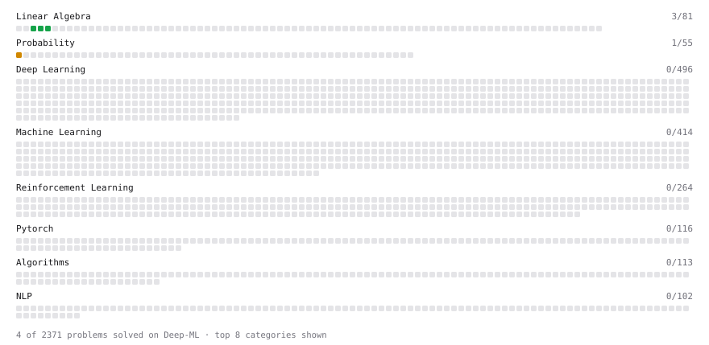

# Deep-ML

My machine learning practice from [Deep-ML](https://www.deep-ml.com). Every solution here was written by hand.

**15** solved · 8 problems · 3 labs · 4 math

[**Browse the interactive portfolio**](https://Darshan-265.github.io/deep-ml/) to replay this filling in over time.

## Problems

| | Difficulty | Solved | |
| --- | --- | --- | --- |
| [Calculate 2x2 Matrix Inverse](https://www.deep-ml.com/problems/8) | easy | 2026-11-22 | [solution](problems/0008-calculate-2x2-matrix-inverse) |
| [Calculate Mean by Row or Column](https://www.deep-ml.com/problems/4) | easy | 2026-11-20 | [solution](problems/0004-calculate-mean-by-row-or-column) |
| [Reshape Matrix](https://www.deep-ml.com/problems/3) | easy | 2026-11-19 | [solution](problems/0003-reshape-matrix) |
| [Scalar Multiplication of a Matrix](https://www.deep-ml.com/problems/5) | easy | 2026-11-20 | [solution](problems/0005-scalar-multiplication-of-a-matrix) |
| [Binomial Distribution Probability](https://www.deep-ml.com/problems/79) | medium | 2026-11-20 | [solution](problems/0079-binomial-distribution-probability) |
| [Calculate Eigenvalues of a Matrix](https://www.deep-ml.com/problems/6) | medium | 2026-11-22 | [solution](problems/0006-calculate-eigenvalues-of-a-matrix) |
| [Normal Distribution PDF Calculator](https://www.deep-ml.com/problems/80) | medium | 2026-11-23 | [solution](problems/0080-normal-distribution-pdf-calculator) |
| [Solve Linear Equations using Jacobi Method](https://www.deep-ml.com/problems/11) | medium | 2026-11-23 | [solution](problems/0011-solve-linear-equations-using-jacobi-method) |

## Labs

| | Difficulty | Solved | |
| --- | --- | --- | --- |
| [Design Your Own Activation Function](https://www.deep-ml.com/labs/9) | easy | 2026-11-19 | [solution](labs/0009-design-your-own-activation-function) |
| [Design Your Own Normalization Layer](https://www.deep-ml.com/labs/24) | easy | 2026-11-21 | [solution](labs/0024-design-your-own-normalization-layer) |
| [Dimensionality Reduction with Sklearn](https://www.deep-ml.com/labs/15) | easy | 2026-11-23 | [solution](labs/0015-dimensionality-reduction-with-sklearn) |

## Math

| | Difficulty | Solved | |
| --- | --- | --- | --- |
| [Matrix Basics](https://www.deep-ml.com/math-problems/9) | easy | 2026-11-20 | [solution](math/0009-matrix-basics) |
| [Vector Operations](https://www.deep-ml.com/math-problems/7) | easy | 2026-11-20 | [solution](math/0007-vector-operations) |
| [Matrix Multiplication](https://www.deep-ml.com/math-problems/10) | medium | 2026-11-20 | [solution](math/0010-matrix-multiplication) |
| [What Each Loss Estimates: Mean, Median, Quantile and Frequency](https://www.deep-ml.com/math-problems/650) | medium | 2026-11-23 | [solution](math/0650-what-each-loss-estimates-mean-median-quantile-and-frequency) |

---

_This file is regenerated by Deep-ML on every push._
